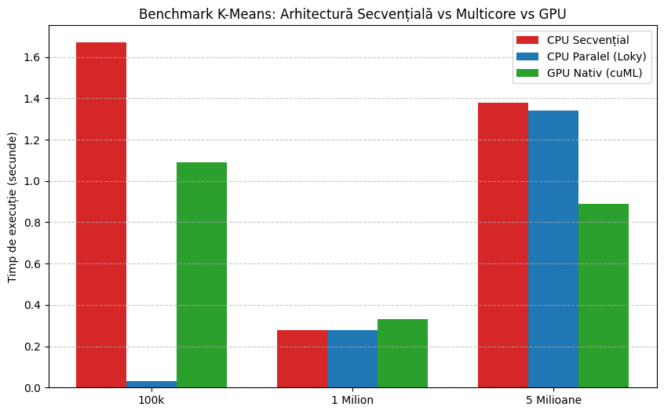

# K-Means: CPU vs. GPU benchmark

> **Status: work in progress / exploratory benchmark.**
> This project started as a university assignment (APD – parallel and distributed algorithms) with the goal of
> *accelerating K-Means on a GPU*. It currently **benchmarks existing implementations** (scikit-learn on CPU,
> RAPIDS cuML on GPU). It does **not** contain a hand-written CUDA kernel yet.

## What it does

- Generates synthetic 2-D datasets (100k, 1M and 5M points, 4 clusters) with `make_blobs`.
- Times K-Means (k = 4) on:
  - **CPU** with scikit-learn (`benchmark_cpu.py`),
  - **GPU** with RAPIDS cuML on Google Colab (`benchmark_gpu.ipynb`).
- Plots the three setups side by side.



*(Chart labels are in Romanian: "Secvențial" = sequential, "Paralel" = parallel, "Milion/Milioane" = million(s).)*

## Results (seconds, lower is better)

| Dataset | CPU "sequential" | CPU "parallel" | GPU (cuML) |
|---------|-----------------:|---------------:|-----------:|
| 100k    | 1.67 | 0.03 | 1.09 |
| 1M      | 0.28 | 0.28 | 0.33 |
| 5M      | 1.38 | 1.34 | 0.89 |

**Honest reading:** the GPU is only clearly ahead at 5M points (~1.5x). At 1M it is on par with the CPU, and
the 100k row is dominated by start-up costs rather than by the algorithm. With only 2 features and 4 clusters the
workload is too small and too low-dimensional for a GPU to really shine, which is a useful finding on its own.
**Please do not treat these numbers as a rigorous comparison** (see the next section).

## Known issues / limitations

These are things I know are wrong or incomplete in the current state:

1. **The "parallel" CPU run is not really different from the "sequential" one.** scikit-learn's `KMeans` already
   uses multi-threading internally (OpenMP). Wrapping `fit` in `joblib.parallel_config(backend='loky', n_jobs=-1)`
   does not change that. The differences in the table (e.g. 1.67 s vs 0.03 s at 100k) come from cold start /
   run order, not from parallelism.
2. **Cold-start effects are not controlled.** The first run in each setup includes library initialisation,
   thread-pool creation and (on GPU) CUDA/cuML context set-up. `benchmark_cpu.py` has a warm-up, but only for the CPU,
   and the GPU notebook has none. Each measurement is a **single run** (no repetitions, no mean/std).
3. **Mixed hardware.** The CPU numbers were measured locally (Ryzen 5 3600, see `docs/`), while the GPU numbers come
   from a Google Colab **T4** (the notebook metadata says so). The comparison is therefore not apples-to-apples.
   The earlier report mentions an RTX 2060, which is not the GPU used in the notebook.
4. **The numbers in the chart are hard-coded** in the notebook (copied by hand from terminal output). The CPU
   outputs are not stored in the repo, so the chart cannot be regenerated from a single run.
5. **GPU timing excludes data loading and transfer.** Only `fit()` is timed; the CSV read into GPU memory is
   printed separately. A fair "end-to-end" comparison should include it.
6. **Result quality is not compared.** I never checked that CPU and GPU produce equivalent clusters
   (inertia / centroids / adjusted Rand index).
7. **`legacy/test_gpu.py` is mislabeled.** It uses `sklearnex` (Intel's scikit-learn extension), which is a CPU
   optimisation and not an NVIDIA GPU path.
8. Some scripts print messages in Romanian and a comment in `generare_date.py` references a course slide ("S12").

## Roadmap

- [ ] Repeat each measurement N times and report mean ± std (with a warm-up on every backend).
- [ ] Run CPU and GPU on the same machine; report hardware and library versions.
- [ ] Make CPU scaling honest: control thread count (`OMP_NUM_THREADS` / `threadpoolctl`) to measure 1 vs. N threads.
- [ ] Add higher-dimensional data (e.g. 32–128 features) and a larger `k`, where a GPU should help more.
- [ ] Write a small custom CUDA kernel (Numba CUDA or CuPy) for the assignment step and compare it with cuML.
- [ ] Verify clustering quality across implementations.
- [ ] Store raw timings in a CSV and generate the chart from it.

## How to run

### 1. Generate the datasets

```bash
pip install -r requirements.txt
python generare_date.py      # creates date_100k.csv, date_1m.csv, date_5m.csv (~230 MB total, git-ignored)
python vizualizare.py        # optional: scatter plot of the 100k dataset
```

### 2. CPU benchmark

```bash
python benchmark_cpu.py
```

### 3. GPU benchmark

Open `benchmark_gpu.ipynb` in Google Colab with a **GPU runtime**, upload the three CSV files, and run all cells.
The first cell installs `cudf-cu12` and `cuml-cu12`.

## Repository layout

```
├── generare_date.py        # synthetic dataset generator (100k / 1M / 5M)
├── benchmark_cpu.py        # CPU timing (scikit-learn)
├── benchmark_gpu.ipynb     # GPU timing (RAPIDS cuML) + comparison chart
├── vizualizare.py          # scatter plot of the data
├── assets/                 # charts used in this README
├── docs/                   # original (Romanian) report + stage-1 screenshots
└── legacy/                 # first-stage prototypes (10k–100k), see legacy/README.md
```

## Tech stack

Python · scikit-learn · RAPIDS cuML / cuDF · NumPy · pandas · matplotlib · Google Colab

## What I learned

- A GPU is not automatically faster: start-up cost and data size matter more than expected.
- How easily a benchmark can mislead (cold start, run order, different machines, single runs).
- That scikit-learn's KMeans is already multi-threaded, so "adding parallelism" on top of it changes nothing.
